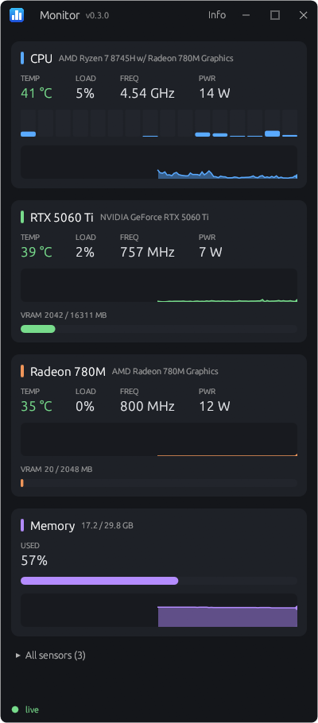

# Taskbar Monitor

A small Windows system monitor in pure Rust. It keeps CPU, GPU and memory readings in your taskbar and includes benchmarks and stress tests.



## Download

| | Best for | Admin rights |
|---|---|---|
| **[Installer (MSI)](https://github.com/rozdaybeda/taskbar-monitor/releases/latest/download/Monitor.msi)** | Most people. Lets you choose CPU sensors, starting with Windows and update checks. | Once, during install |
| **[Portable (zip)](https://github.com/rozdaybeda/taskbar-monitor/releases/latest/download/Monitor-portable.zip)** | Running without installing the app. | Once, if you turn on CPU sensors |

Needs 64-bit Windows.

Releases aren't code-signed yet, so Windows may warn that the publisher is unknown.

## Features

- **CPU:** temperature, frequency, power and load, including per-core load and clocks
- **GPU:** temperature, clock, load, power and video memory, for every NVIDIA and AMD GPU
- **Memory:** usage and history
- **Taskbar widget:** choose what it shows, and whether it sits on the taskbar or floats
- **Tray icon:** runs quietly in the background
- **Device info:** specs for your CPU and GPUs
- **Benchmarks:** bandwidth, latency and throughput for CPU, memory and GPU
- **Stress tests:** for CPU and GPU, with start and stop, and a temperature limit

## Why it needs admin rights

Windows only lets kernel drivers read CPU temperature, frequency and power. Everything else works without admin rights.

Monitor uses the signed [PawnIO](https://pawnio.eu) driver, whose modules allow only the CPU registers they list. A small Windows service reads the sensors and passes the values to the app, so the app itself never runs as admin or touches the driver. Other programs can read those sensor values, but can't use the service to reach the driver.

## Privacy

Monitor doesn't send your readings or anything about your PC anywhere. The one thing it does online is ask GitHub once a day whether there's a newer version, and GitHub sees your IP address, as with any web request. You can turn this off during install or in the tray menu. Portable copies never check.

## Uninstalling

- **Installer:** use Installed apps in Windows Settings.
- **Portable:** run `uninstall-sensors.bat` if you turned on CPU sensors, then delete the folder.

Both leave the PawnIO driver in place, because other apps can share it. It has its own entry in Installed apps. Your settings and logs also stay, in `%APPDATA%\Monitor`, or in the `data` folder for a portable copy.

## Hardware support

Developed on an AMD Ryzen with Radeon and NVIDIA GPUs. CPU sensors support AMD Zen and newer, and Intel CPUs, though the Intel code hasn't been tested on real hardware yet. Reports are welcome. Intel GPUs aren't supported.

## Building

```powershell
.\fetch-pawnio.ps1               # downloads the PawnIO files, once
cargo build --release
.\installer\build-release.ps1    # builds the MSI and portable zip
```

See [ARCHITECTURE.md](ARCHITECTURE.md) for how it works and how releases are made.

## License

[MIT](LICENSE). The bundled PawnIO components and the Rust libraries have their own licences: see [the notices](installer/licenses/THIRD-PARTY-NOTICES.txt).
